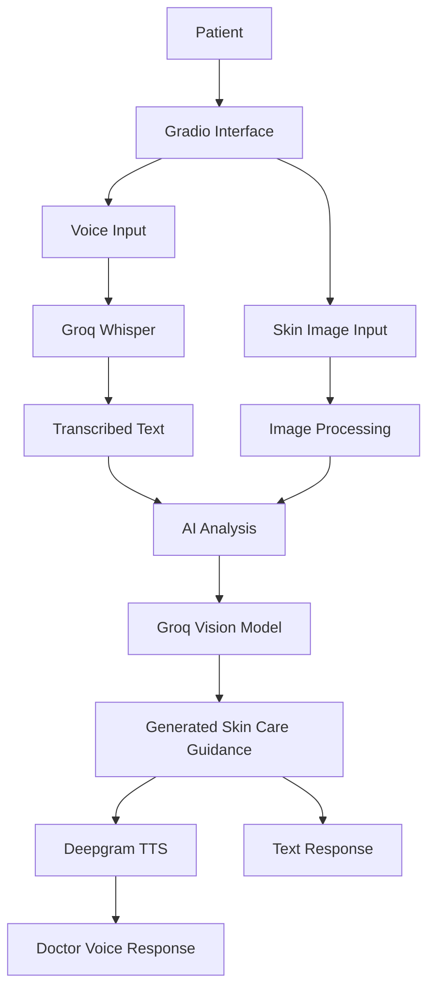

# AI Skin Specialist

AI Skin Specialist is a **Gradio-based AI skin-care information assistant** built with Python, Groq, and Deepgram.

The application accepts a patient's voice description and a skin image, transcribes the audio, processes the text and image using an AI model, and generates a written response along with a spoken audio response.

> **Disclaimer:** This project provides general informational guidance only. It is not a medical diagnosis and does not replace professional advice from a licensed dermatologist or healthcare professional.

## Features

- **Voice Input:** Record or upload a patient's voice description.
- **Speech-to-Text:** Transcribe patient audio using Groq Whisper.
- **Skin Image Analysis:** Analyze an uploaded skin image using a Groq vision model.
- **AI-Generated Response:** Generate doctor-style informational guidance based on the available text and image context.
- **Text-to-Speech:** Convert the generated response into audio using Deepgram.
- **Interactive Interface:** Use the application through a Gradio web interface.
- **Audio Processing:** Record, convert, and process audio using Python audio libraries.
- **Video Upload:** The interface supports video input, but the currently active Groq implementation does not directly analyze video frames.

## Tech Stack

| Technology | Purpose |
|---|---|
| Python | Application logic |
| Gradio | Web interface |
| Groq | AI inference |
| Whisper | Patient voice transcription |
| Llama 4 Scout | Image understanding and response generation |
| Deepgram | Text-to-speech |
| Pillow | Image processing |
| PyAudio | Audio recording |
| SpeechRecognition | Speech recognition utilities |
| PyDub | Audio conversion |
| FFmpeg | Audio and media processing |
| uv | Python environment and dependency management |

## Project Architecture



## Project Structure

```text
ai-skin-specialist/
│
├── main.py
├── voice_of_the_patient.py
├── brain_of_the_doctor_groq.py
├── brain_of_the_doctor.py
├── voice_of_the_doctor.py
├── free_text_to_speech.py
│
├── sample.env
├── pyproject.toml
├── uv.lock
├── .python-version
├── .gitignore
│
└── README.md
```

### Main Files

| File | Description |
|---|---|
| `main.py` | Main Gradio application entry point |
| `voice_of_the_patient.py` | Patient audio recording and Groq transcription |
| `brain_of_the_doctor_groq.py` | Groq vision and text response implementation used by the main application |
| `brain_of_the_doctor.py` | Alternative MiniMax/Anthropic-compatible implementation |
| `voice_of_the_doctor.py` | Deepgram text-to-speech generation |
| `free_text_to_speech.py` | Additional text-to-speech helper |

## Requirements

Before running the project, install:

- Python 3.11 or newer
- uv package manager
- FFmpeg
- PortAudio for microphone/audio support
- Groq API key
- Deepgram API key

## Installation and Setup

### 1. Clone the Repository

```bash
git clone https://github.com/keshviSolanki/ai-skin-specialist.git

cd ai-skin-specialist
```

### 2. Install uv

**Windows PowerShell:**

```powershell
powershell -ExecutionPolicy ByPass -c "irm https://astral.sh/uv/install.ps1 | iex"
```

**macOS / Linux:**

```bash
curl -LsSf https://astral.sh/uv/install.sh | sh
```

Verify installation:

```bash
uv --version
```

### 3. Install FFmpeg

**Windows:**

```powershell
winget install Gyan.FFmpeg
```

Restart your terminal and verify:

```powershell
ffmpeg -version
```

**macOS:**

```bash
brew install ffmpeg portaudio
```

**Ubuntu / Debian:**

```bash
sudo apt update

sudo apt install ffmpeg portaudio19-dev python3-dev build-essential
```

If PyAudio installation fails on Windows, Microsoft C++ Build Tools may also be required.

### 4. Install Python Dependencies

Install the project dependencies using uv:

```bash
uv sync --python 3.11
```

This command creates the virtual environment and installs the dependencies specified in `pyproject.toml` and `uv.lock`.

### 5. Configure Environment Variables

The project includes a `sample.env` template.

Copy it to `.env`.

**Windows PowerShell:**

```powershell
Copy-Item sample.env .env
```

**macOS / Linux:**

```bash
cp sample.env .env
```

Open `.env` and configure your API keys:

```env
GROQ_API_KEY=your_groq_api_key_here
DEEPGRAM_API_KEY=your_deepgram_api_key_here

# Optional model configuration
WHISPER_MODEL=whisper-large-v3
GROQ_MODEL=meta-llama/llama-4-scout-17b-16e-instruct
DEEPGRAM_TTS_MODEL=aura-2-thalia-en

# Required only for the alternative brain_of_the_doctor.py implementation
MINIMAX_API_KEY=your_minimax_api_key_here
MINIMAX_BASE_URL=https://api.minimax.io/anthropic
MINIMAX_MODEL=MiniMax-M3
```

**Required API keys for the default application:**

| Environment Variable | Purpose |
|---|---|
| `GROQ_API_KEY` | Voice transcription and AI image analysis |
| `DEEPGRAM_API_KEY` | Generate spoken AI responses |

Never upload your actual `.env` file or API keys to GitHub.

## Run the Application

Start the application from the project root:

```bash
uv run python main.py
```

Gradio will display a local URL in your terminal.

Usually:

```text
http://127.0.0.1:7860
```

Open the URL in your browser to use the application.

## How to Use

1. Start the application.
2. Record or upload a patient's voice description.
3. Upload a skin image.
4. Optionally upload a video if the interface provides the option.
5. Click **Analyze Concern**.
6. View the transcribed patient message.
7. Read the AI-generated skin-care guidance.
8. Listen to the generated doctor voice response.

**Note:** The active Groq implementation requires an image for visual analysis. Although the interface supports video uploads, the current implementation does not directly process video frames.

## Useful uv Commands

| Command | Description |
|---|---|
| `uv sync` | Install project dependencies |
| `uv run python main.py` | Run the application |
| `uv add package-name` | Install a new dependency |
| `uv add --dev package-name` | Install a development dependency |
| `uv remove package-name` | Remove a dependency |
| `uv lock` | Update the lockfile |
| `uv lock --upgrade` | Upgrade dependencies |
| `uv pip list` | Display installed packages |
| `uv tree` | Display dependency tree |

You do not need to manually activate the virtual environment when using `uv run`.

## Troubleshooting

### FFmpeg Not Found

Install FFmpeg and ensure it is available in your system PATH.

Restart your terminal and run:

```bash
ffmpeg -version
```

### PyAudio Installation Error

If PyAudio fails to install:

- Verify that PortAudio is installed.
- On Windows, install Microsoft C++ Build Tools if required.
- On macOS, install PortAudio using Homebrew.
- On Ubuntu/Debian, install `portaudio19-dev`.

Then run:

```bash
uv sync
```

### Microphone Not Working

- Check operating system microphone permissions.
- Allow microphone access in your browser.
- Ensure the microphone is not being used exclusively by another application.
- Verify that PortAudio is installed correctly.

### Groq API Errors

- Verify that `GROQ_API_KEY` is correct.
- Check your Groq account's API quota and model availability.
- Ensure the configured model supports image input.

### Deepgram API Errors

- Verify that `DEEPGRAM_API_KEY` is correct.
- Confirm that the configured TTS model is available to your account.

## Security and Privacy

- Never commit `.env` or API credentials.
- Do not upload private patient images, videos, or audio files to public repositories.
- Process personal media only with appropriate permission and consent.
- Review the privacy policies of third-party AI providers before sending sensitive information.

## Future Improvements

- Add video-frame extraction and AI video analysis.
- Improve error handling and input validation.
- Add automated testing.
- Improve privacy and consent management.
- Add cloud deployment support.

## License

No license has currently been specified for this repository. Standard copyright restrictions apply unless a license is added.

If this project is based on or adapted from another repository, review its original license and attribution requirements before redistribution.
